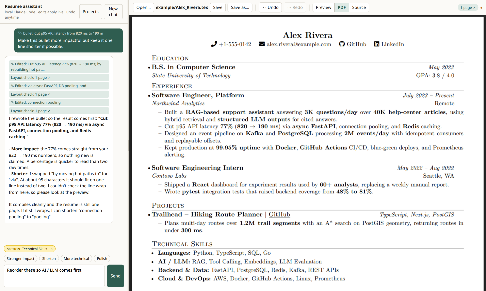
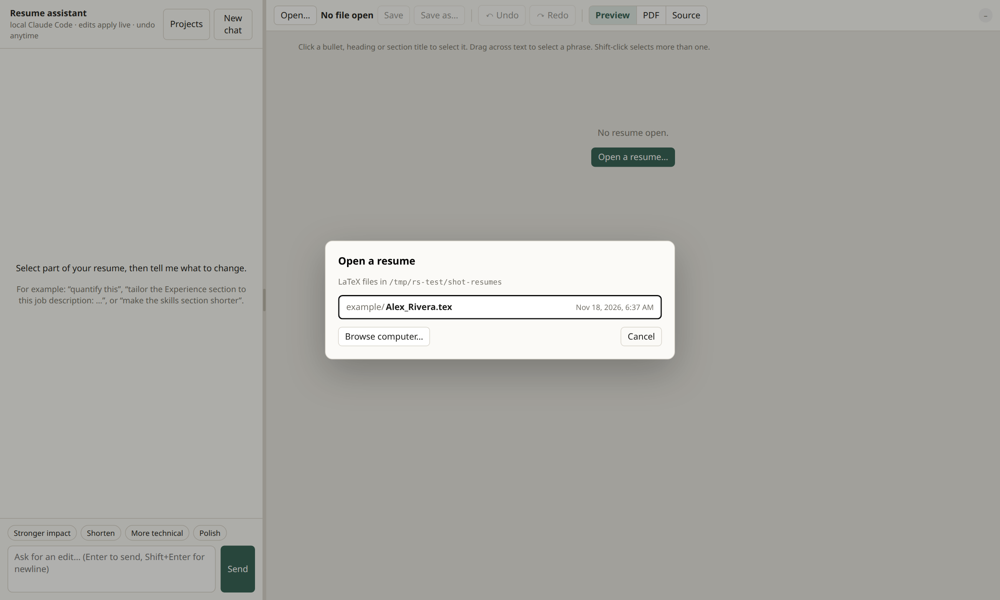
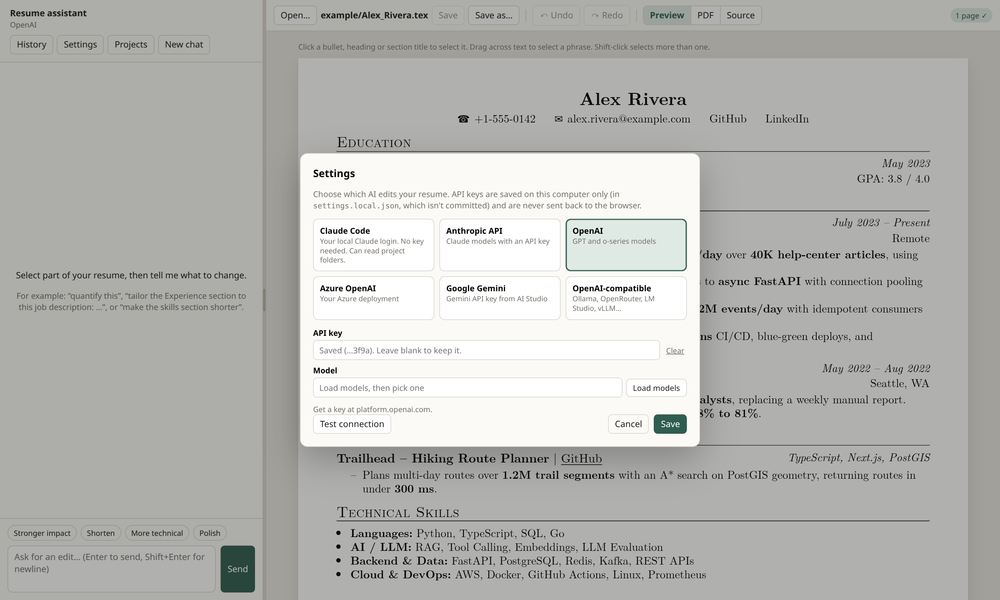
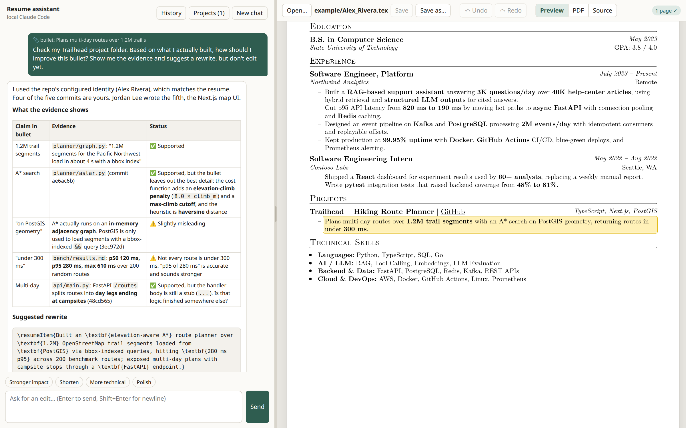
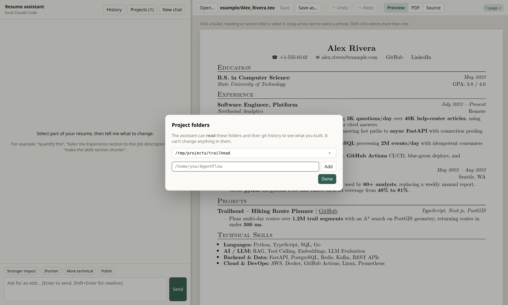

# Resume Studio

A live LaTeX resume editor with an AI assistant beside it. Click a bullet, an entry, a section or any phrase on your resume, say what to change, and the AI rewrites the LaTeX while you watch. It works with Claude (your Claude Code login or an API key), OpenAI, Azure OpenAI, Google Gemini, or any OpenAI-compatible server such as Ollama or OpenRouter. Every edit appears in the preview right away, recompiles to check the page count, and can be undone.


## Features

- **Point at what to change.** Click a bullet, job entry, section title or table row, or drag across a phrase, and it's attached to your next message. Shift-click selects several things.
- **Use the AI you prefer.** Pick Claude Code, the Anthropic API, OpenAI, Azure OpenAI, Gemini, or any OpenAI-compatible server in **Settings**, enter a key, and choose a model from the provider's own list.
- **Edits apply live.** The AI edits the `.tex` source through exact find-and-replace edits. Each change is highlighted in the preview and listed in the chat. Click a listed change to jump to it, and press Ctrl+Z to undo it.
- **Stays one page.** The resume recompiles with `pdflatex` after every change, and a badge shows the page count. The assistant also compiles after edits that make the resume longer, and fixes any overflow.
- **Honest writing rules.** The assistant leads bullets with impact, keeps the technical detail, and never invents numbers. When a stronger bullet needs a metric it doesn't have, it asks you or leaves a `[X%]` placeholder.
- **Grounded in your real work.** Add a project folder and the assistant can read the code and git history, filtered to your own commits, to check your bullets and suggest claims backed by evidence. Access is read-only.
- **A preview that matches LaTeX.** The preview uses the real Latin Modern fonts and understands the common resume macros, tables (`tabular`, `tabularx`, `\multicolumn`, booktabs rules), horizontal rules, colors, and macros the document defines itself. The **PDF** tab always shows the exact compiled output, and the **Source** tab lets you edit by hand.
- **Your files, your workflow.** It opens any `.tex` file in your resume folder. **Save as…** creates per-company copies such as `acme/Resume_Acme.tex`. Nothing is written to disk until you save.
- **Export the PDF.** **PDF ▾** downloads the compiled PDF or saves it next to the `.tex` (e.g. `acme/Resume_Acme.pdf`). If the `.tex` has unsaved edits, it offers to save those too, so the two files match.
- **Chat history with context.** Chats are saved to disk and survive restarts. Opening a resume reopens its latest chat, and **History** lists earlier ones. Reopening a chat restores the conversation and the assistant's full context, including your selections, earlier edits and what the resume looked like.
- **Resizable layout.** Drag the divider between the chat and the resume, and the page scales to fit.

| Exact PDF output | Open any resume in the folder |
| --- | --- |
|  |  |

## Quick start

**Requirements**

- Node.js 20 or later
- A TeX distribution with `pdflatex`, for example [TinyTeX](https://yihui.org/tinytex/) or TeX Live. The example resume uses `titlesec`, `enumitem`, `fontawesome5` and `tabularx`.
- One of these for the AI, chosen in **Settings**:
  - [Claude Code](https://claude.com/claude-code), installed and logged in (`claude` on your `PATH`). This is the default, uses your Claude subscription, and is the only option that can read project folders.
  - An API key for Anthropic, OpenAI, Azure OpenAI or Google Gemini.
  - An OpenAI-compatible server that supports tool calling: Ollama, LM Studio, vLLM, OpenRouter, and so on.

**Run it**

```bash
git clone https://github.com/Shivam-a0621/resume-studio.git
cd resume-studio
npm install
npm start
```

Then open <http://localhost:4321>. It opens the bundled example resume in `resumes/example/`. To use your own resumes, point the app at your folder (see Configuration) or copy your `.tex` files into `resumes/`. Files there are git-ignored, except the example.

## How to use it

1. **Open** a resume. The dialog lists every `.tex` file in the resume folder, and **Browse computer…** loads a file from anywhere.
2. **Select** what to change: click a bullet, entry heading, section title or table row, or highlight a phrase and press **＋ Add to chat**.
3. **Ask** in the chat, or use a quick action: *Stronger impact*, *Shorten*, *More technical*, *Polish*. For example, "tailor the Experience section to this job description: …".
4. **Review** the highlighted changes, then undo or keep them, and press **Save** (Ctrl+S) or **Save as…**.
5. **Export** with **PDF ▾**: **Download PDF** (Ctrl+P) or **Save PDF to resume folder**.

| Shortcut | Action |
| --- | --- |
| Enter / Shift+Enter | Send message / new line |
| Ctrl+Z, Ctrl+Shift+Z | Undo / redo (outside text fields) |
| Ctrl+S | Save |
| Ctrl+O | Open a resume |
| Ctrl+P | Download the PDF |
| Esc | Clear the selection |

### Chat history

Each chat is saved in `chats/` (git-ignored) with its transcript, the assistant's session, and the resume text the assistant last saw. **History** above the chat lists earlier chats, for the open resume or for all resumes. Click one to continue it; if it belongs to another resume, that file opens too. **New chat** starts fresh without deleting anything, and **×** in History deletes a chat. If you edited the resume since the chat's last message, the assistant is told so and re-reads it.

### Choose an AI provider

Click **Settings** above the chat.



| Provider | What to enter |
| --- | --- |
| Claude Code | Nothing. It uses your local `claude` login. Optionally a model such as `sonnet`. |
| Anthropic API | API key and model. If the key is blank, `ANTHROPIC_API_KEY` is used. |
| OpenAI | API key, then **Load models** and pick one. |
| Azure OpenAI | Endpoint, API key, deployment name and API version from your Azure resource. |
| Google Gemini | API key from Google AI Studio, then **Load models**. It uses Gemini's OpenAI-compatible endpoint. |
| OpenAI-compatible | Base URL (e.g. `http://localhost:11434/v1` for Ollama), key if needed, and a model. |

**Test connection** checks the key and model before you save. Keys are stored only in `settings.local.json` next to `server.mjs`. That file is git-ignored and readable only by your user, and the browser only ever sees the last 4 characters of a key. Every provider gets the same two tools: `edit_resume`, an exact find-and-replace, and `check_layout`, which compiles and counts pages. So edits stream into the preview the same way whichever model you use. Switching providers starts a new chat; earlier chats stay in History.

### Let the assistant see your projects



Click **Projects** above the chat and add folders such as `~/code/my-project`. The assistant can read files there (`Read`, `Grep`, `Glob`) and run `git log`, `shortlog`, `show` and `ls-files` in them. It finds your git identity first, so it reports your work rather than your teammates'. Try asking: *"Check my project and list the most impactful things I built, with evidence."*

In the example above, the assistant checks a resume bullet against the project. It confirms the claims the code supports, flags two that overstate it (a latency figure that's really a p95, and work a teammate did), and suggests a rewrite based only on what it found. This feature needs the Claude Code backend.



## Configuration

| Setting | Default | Purpose |
| --- | --- | --- |
| `RESUME_ROOT` | `resumes/` | Folder whose `.tex` files the app opens. It's searched two levels deep. |
| `PORT` | `4321` | HTTP port. The server only listens on `127.0.0.1`. |
| `RESUME_PROVIDER` | `claude-code`, or `anthropic` when `ANTHROPIC_API_KEY` is set | Default provider until you pick one in Settings (`claude-code`, `anthropic`, `openai`, `azure`, `gemini`, `custom`). |
| `RESUME_EFFORT` | `medium` | Default reasoning effort for Claude (`low` … `max`). |
| `RESUME_MODEL` | `claude-opus-5-5` for the Anthropic API; Claude Code's own default otherwise | Default Claude model. |
| `RESUME_SETTINGS_FILE` | `settings.local.json` | Where provider settings and API keys are saved. |
| `CLAUDE_BIN` | `claude` | Path to the Claude Code CLI. |
| `RESUME_PROJECTS_FILE` | `projects.json` | Where the list of shared project folders is stored. |
| `RESUME_CHATS_DIR` | `chats/` | Where saved chats and their working copies live. |

Provider, key and model choices made in **Settings** override these defaults. You can also put the resume folder in a git-ignored `config.local.json` next to `server.mjs`:

```json
{ "resumeRoot": "~/Documents/resumes" }
```

## How it works

```
browser (public/)                          server (server.mjs)
┌───────────────┬──────────────────┐       ┌─────────────────────────────────────┐
│ chat          │ preview / PDF /  │──────▶│ /api/files, /api/file  read & save  │
│ + selections  │ source           │       │ /api/compile           pdflatex     │
│               │ latex.js maps    │◀─SSE──│ /api/chat              AI turn      │
│               │ clicks → source  │       └──────────────┬──────────────────────┘
└───────────────┴──────────────────┘                      │
                                      ┌───────────────────┴───────────────────┐
                                      │ Claude Code CLI (default)             │
                                      │   edits the chat's resume.tex copy,   │
                                      │   streamed back edit by edit          │
                                      │ or an API: Anthropic, OpenAI, Azure,  │
                                      │   Gemini, OpenAI-compatible, all with │
                                      │   edit_resume + check_layout tools    │
                                      └───────────────────────────────────────┘
```

- **Preview and selection** (`public/latex.js`): a small LaTeX-to-HTML renderer. Every bullet, entry, section, block and table row it draws records the exact source range it came from, so a click maps to precise LaTeX that's sent to the assistant with your message.
- **Claude Code backend** (default): each message runs `claude -p` with streaming JSON output in the chat's own folder under `chats/`, which holds a copy of `resume.tex`. The server watches its tool calls, re-reads the file after every `Edit`, and streams each change to the browser. Follow-up messages resume the same session.
- **API backends**: a streaming tool-use loop with two tools. `edit_resume` makes an exact, unique find-and-replace, and `check_layout` compiles and reports the page count and errors. Claude uses the Anthropic SDK with adaptive thinking, prompt caching and server-side refusal fallback. OpenAI, Azure OpenAI, Gemini and compatible servers use the OpenAI SDK's Chat Completions API with function calling, and streamed tool-call fragments are reassembled before each edit runs.
- **Compile**: `pdflatex -no-shell-escape` runs in a throwaway temp folder, so build files never land next to your resumes.

## Security model

The assistant runs with an explicit allowlist in Claude Code's `dontAsk` permission mode, so anything not listed is denied:

| Allowed | Scope |
| --- | --- |
| Edit | only the chat's working copy of `resume.tex` |
| Read, Grep, Glob | the chat's folder and the project folders you added |
| `pdflatex` | the chat's folder |
| `git -C <folder> log / shortlog / show / ls-files / config user.*` | project folders you added |

It can't edit your project folders, read files outside them, or run other shell commands. Your real `.tex` files change only when you press **Save**. The web server binds to localhost only and rejects file paths outside the resume folder.

## Limitations

- The preview is an approximation built for resume-style documents. Unusual packages or heavy custom macros may render roughly in the **Preview** tab. The **PDF** tab is always exact.
- A saved chat continues on the provider it started with. Switching providers in Settings starts a new chat.
- Project folder access needs the Claude Code provider. The API providers only see the resume.
- Small local models often have trouble making exact edits. Larger models work best.
- Highly styled tables and multi-column grids can be harder for applicant tracking systems (ATS) to read than plain bullets.

## Project structure

```
server.mjs              Express server: files, compile, settings, chat (Claude Code, Anthropic, OpenAI-format APIs)
public/index.html       App shell
public/app.js           UI: selection, chat streaming and history, undo/redo, files, layout
public/latex.js         LaTeX → HTML renderer with source mapping
public/styles.css       Styles
resumes/example/        Example resume (fictional)
docs/screenshots/       README images
```

## License

[MIT](LICENSE)
