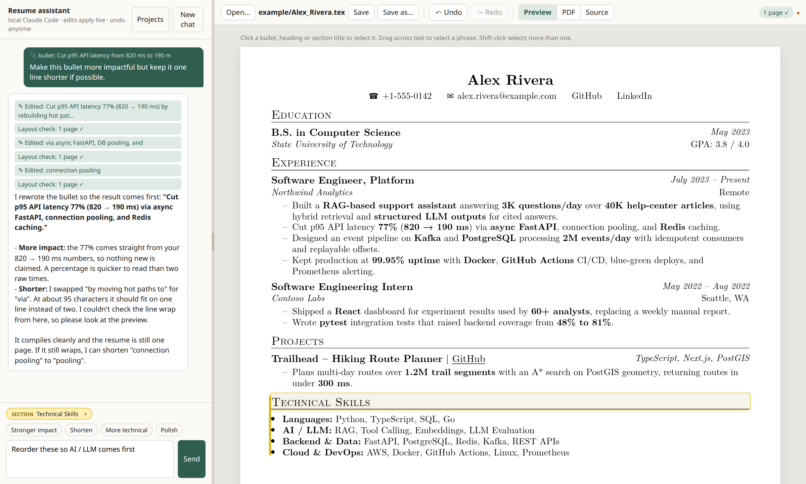

# Resume Studio

A live LaTeX resume editor with an AI assistant beside it. Click a bullet, an entry, a section or any phrase on your resume, say what to change, and Claude rewrites the LaTeX while you watch. Every edit appears in the preview right away, recompiles to check the page count, and can be undone.



## Features

- **Point at what to change.** Click a bullet, job entry, section title or table row, or drag across a phrase, and it's attached to your next message. Shift-click selects several things.
- **Edits apply live.** Claude edits the `.tex` source through exact find-and-replace edits. Each change is highlighted in the preview and listed in the chat. Click a listed change to jump to it, and press Ctrl+Z to undo it.
- **Stays one page.** The resume recompiles with `pdflatex` after every change, and a badge shows the page count. The assistant also compiles after edits that make the resume longer, and fixes any overflow.
- **Honest writing rules.** The assistant leads bullets with impact, keeps the technical detail, and never invents numbers. When a stronger bullet needs a metric it doesn't have, it asks you or leaves a `[X%]` placeholder.
- **Grounded in your real work.** Add a project folder and the assistant can read the code and git history, filtered to your own commits, to suggest claims backed by evidence. Access is read-only.
- **A preview that matches LaTeX.** The preview uses the real Latin Modern fonts and understands the common resume macros, tables (`tabular`, `tabularx`, `\multicolumn`, booktabs rules), horizontal rules, colors, and macros the document defines itself. The **PDF** tab always shows the exact compiled output, and the **Source** tab lets you edit by hand.
- **Your files, your workflow.** It opens any `.tex` file in your resume folder. **Save as…** creates per-company copies such as `acme/Resume_Acme.tex`. Nothing is written to disk until you save.
- **Resizable layout.** Drag the divider between the chat and the resume, and the page scales to fit.

| Exact PDF output | Open any resume in the folder |
| --- | --- |
|  |  |

## Quick start

**Requirements**

- Node.js 20 or later
- A TeX distribution with `pdflatex`, for example [TinyTeX](https://yihui.org/tinytex/) or TeX Live. The example resume uses `titlesec`, `enumitem`, `fontawesome5` and `tabularx`.
- One of these for the AI:
  - [Claude Code](https://claude.com/claude-code), installed and logged in (`claude` on your `PATH`). This is the default and uses your Claude subscription.
  - An Anthropic API key in `ANTHROPIC_API_KEY`.

**Run it**

```bash
git clone https://github.com/Shivam-a0621/resume-studio.git
cd resume-studio
npm install
npm start
```

Then open <http://localhost:4321>. It opens the bundled example resume in `resumes/example/`. To use your own resumes, point the app at your folder (see Configuration) or copy your `.tex` files into `resumes/`. Files there are git-ignored, except the example.

## How to use it

1. **Open** a resume. The dialog lists every `.tex` file in the resume folder, and **Browse computer…** loads a file from anywhere.
2. **Select** what to change: click a bullet, entry heading, section title or table row, or highlight a phrase and press **＋ Add to chat**.
3. **Ask** in the chat, or use a quick action: *Stronger impact*, *Shorten*, *More technical*, *Polish*. For example, "tailor the Experience section to this job description: …".
4. **Review** the highlighted changes, then undo or keep them, and press **Save** (Ctrl+S) or **Save as…**.

| Shortcut | Action |
| --- | --- |
| Enter / Shift+Enter | Send message / new line |
| Ctrl+Z, Ctrl+Shift+Z | Undo / redo (outside text fields) |
| Ctrl+S | Save |
| Ctrl+O | Open a resume |
| Esc | Clear the selection |

### Let the assistant see your projects

Click **Projects** above the chat and add folders such as `~/code/my-project`. The assistant can read files there (`Read`, `Grep`, `Glob`) and run `git log`, `shortlog`, `show` and `ls-files` in them. It finds your git identity first, so it reports your work rather than your teammates'. Try asking: *"Check my project and list the most impactful things I built, with evidence."* This feature needs the Claude Code backend.

## Configuration

| Setting | Default | Purpose |
| --- | --- | --- |
| `RESUME_ROOT` | `resumes/` | Folder whose `.tex` files the app opens. It's searched two levels deep. |
| `PORT` | `4321` | HTTP port. The server only listens on `127.0.0.1`. |
| `RESUME_PROVIDER` | `claude-code` without an API key, `api` with one | Which AI backend to use. |
| `RESUME_EFFORT` | `medium` | Reasoning effort (`low` … `max`). Higher is more careful but slower. |
| `RESUME_MODEL` | `claude-opus-5-5` for the API; Claude Code's own default otherwise | Model override. |
| `CLAUDE_BIN` | `claude` | Path to the Claude Code CLI. |
| `RESUME_PROJECTS_FILE` | `projects.json` | Where the list of shared project folders is stored. |

You can also put settings in a git-ignored `config.local.json` next to `server.mjs`:

```json
{ "resumeRoot": "~/Documents/resumes" }
```

## How it works

```
browser (public/)                          server (server.mjs)
┌───────────────┬──────────────────┐       ┌─────────────────────────────────────┐
│ chat          │ preview / PDF /  │──────▶│ /api/files, /api/file  read & save  │
│ + selections  │ source           │       │ /api/compile           pdflatex     │
│               │ latex.js maps    │◀─SSE──│ /api/chat              AI turn      │
│               │ clicks → source  │       └──────────────┬──────────────────────┘
└───────────────┴──────────────────┘                      │
                                      ┌───────────────────┴───────────────────┐
                                      │ Claude Code CLI (default)             │
                                      │   edits a temp copy of resume.tex,    │
                                      │   streamed back edit by edit          │
                                      │ or the Claude API (@anthropic-ai/sdk) │
                                      │   edit_resume + check_layout tools    │
                                      └───────────────────────────────────────┘
```

- **Preview and selection** (`public/latex.js`): a small LaTeX-to-HTML renderer. Every bullet, entry, section, block and table row it draws records the exact source range it came from, so a click maps to precise LaTeX that's sent to the assistant with your message.
- **Claude Code backend** (default): each message runs `claude -p` with streaming JSON output in a per-conversation temp folder that holds a copy of `resume.tex`. The server watches its tool calls, re-reads the file after every `Edit`, and streams each change to the browser. Follow-up messages resume the same session.
- **API backend**: a streaming tool-use loop on the Claude API with two tools. `edit_resume` makes an exact, unique find-and-replace, and `check_layout` compiles and reports the page count and errors. It uses adaptive thinking, prompt caching, and server-side refusal fallback.
- **Compile**: `pdflatex -no-shell-escape` runs in a throwaway temp folder, so build files never land next to your resumes.

## Security model

The assistant runs with an explicit allowlist in Claude Code's `dontAsk` permission mode, so anything not listed is denied:

| Allowed | Scope |
| --- | --- |
| Edit | only the temp copy of `resume.tex` |
| Read, Grep, Glob | the temp folder and the project folders you added |
| `pdflatex` | the temp folder |
| `git -C <folder> log / shortlog / show / ls-files / config user.*` | project folders you added |

It can't edit your project folders, read files outside them, or run other shell commands. Your real `.tex` files change only when you press **Save**. The web server binds to localhost only and rejects file paths outside the resume folder.

## Limitations

- The preview is an approximation built for resume-style documents. Unusual packages or heavy custom macros may render roughly in the **Preview** tab. The **PDF** tab is always exact.
- Chat history is kept in memory and resets when the server restarts.
- Highly styled tables and multi-column grids can be harder for applicant tracking systems (ATS) to read than plain bullets.

## Project structure

```
server.mjs              Express server: files, compile, chat (Claude Code CLI or Claude API)
public/index.html       App shell
public/app.js           UI: selection, chat streaming, undo/redo, files, layout
public/latex.js         LaTeX → HTML renderer with source mapping
public/styles.css       Styles
resumes/example/        Example resume (fictional)
docs/screenshots/       README images
```

## License

[MIT](LICENSE)
